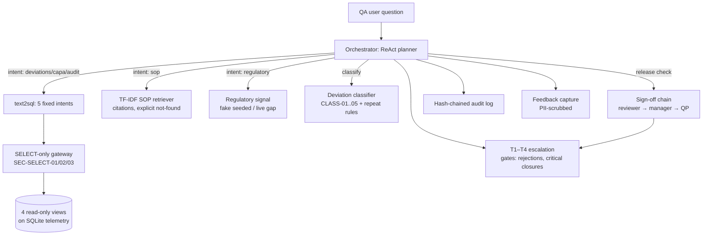

# Architecture

## Data flow
1. Synthetic telemetry (batches, deviations, CAPAs, sign-offs, findings) is
   seeded deterministically into SQLite; 4 read-only views expose it.
2. The orchestrator detects intents and fans out: SQL intents go through the
   SELECT-only gateway; SOP questions go to TF-IDF retrieval; regulatory
   questions go to the fake feed (the live stub reports a gap).
3. Release questions run the sign-off chain: each role's criterion is checked
   against live data and the first failing role blocks the chain with its
   reason cited.
4. Every turn, classification, and gate decision is appended to the
   hash-chained audit log; user feedback is PII-scrubbed before storage.
